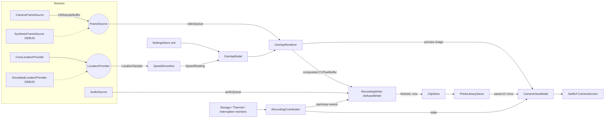

# SpeedCam — Design

Spec: [spec.md](spec.md). Status: Draft.

## 1. Stack

- Swift 6, SwiftUI, AVFoundation, CoreLocation, Core Image (Metal-backed `CIContext`), Photos, UIKit only where SwiftUI lacks an API (preview layer, idle timer).
- Min iOS 17. No third-party dependencies.
- Project generated by xcodegen from `project.yml` (`/opt/homebrew/bin/xcodegen`); the `.xcodeproj` is generated, not hand-edited.
- Targets: `SpeedCam` (app), `SpeedCamTests` (unit), `SpeedCamUITests` (UI). Configurations: Debug, Release.

## 2. Repository layout

```
project.yml
SpeedCam/
  App/            SpeedCamApp.swift, AppEnvironment.swift (composition root), Info.plist
  Capture/        CaptureSessionService, FrameSource, CameraFrameSource, AudioSource
  Location/       LocationProvider, CoreLocationProvider, SpeedSmoother, SpeedReading
  Overlay/        OverlayModel, OverlayRenderer
  Recording/      RecordingWriter, RecordingCoordinator, StorageMonitor, ClipRecovery
  Library/        PhotoLibrarySaver, ClipStore
  Permissions/    PermissionsService
  System/         ThermalMonitor, InterruptionMonitor, IdleTimerController, Haptics
  Settings/       SettingsStore (UserDefaults)
  UI/             RootView, OnboardingView, CameraScreen, CameraViewModel, PreviewView, ControlsView, StatusViews, Toasts
  Debug/          (#if DEBUG) SyntheticFrameSource, SimulatedLocationProvider, LaunchArguments, AutoRecordRunner
SpeedCamTests/
SpeedCamUITests/
scripts/          extract-frame.sh, check-traceability.sh
specs/dashcam/
```

## 3. Components

| Component | Responsibility | Key API (shape, not code) |
|---|---|---|
| `FrameSource` (protocol) | Delivers video `CMSampleBuffer`s (BGRA/420f) with presentation timestamps and orientation on a callback queue. | `start()`, `stop()`, `onFrame`, `dimensions`, `isAvailable` |
| `CameraFrameSource` | `AVCaptureSession` + back wide camera + `AVCaptureVideoDataOutput` (`alwaysDiscardsLateVideoFrames = true`). | implements `FrameSource` |
| `SyntheticFrameSource` (DEBUG) | Generates 1920×1080 frames at 30 fps (moving gradient, frame counter, clock) via `CVPixelBufferPool`, host-clock timestamps. | implements `FrameSource` |
| `AudioSource` | `AVCaptureAudioDataOutput` on the same session; nil when mic denied or synthetic mode (synthetic may emit silence). | `onAudio` |
| `CaptureSessionService` | Owns the `AVCaptureSession` lifecycle, configuration, interruptions (`AVCaptureSession.wasInterrupted`, runtime errors), preview layer. Chooses camera vs synthetic source via `AppEnvironment`. | `configure()`, `start()`, `stop()`, `events` |
| `LocationProvider` (protocol) | Emits raw `LocationSample { speedMps, speedAccuracy, horizontalAccuracy, timestamp }` and authorization status. | `start()`, `stop()`, `samples: AsyncStream`, `authorization` |
| `CoreLocationProvider` | `CLLocationManager`, When In Use, `BestForNavigation`, `activityType = .automotiveNavigation`. Started only while app is foreground. Works with `xcrun simctl location`. | implements `LocationProvider` |
| `SimulatedLocationProvider` (DEBUG) | Deterministic scenarios: `constant50kmh`, `accelerate`, `invalid`, `noFix`, `weak`. | implements `LocationProvider` |
| `SpeedSmoother` | Pure value logic: validity filtering, EMA smoothing, stationary clamp, staleness, unit conversion → `SpeedReading { display: String /* "50" or "--" */, unit, gps: .good/.weak/.noFix/.off }`. Injected clock. | `ingest(sample)`, `reading(at:)` |
| `OverlayModel` | Snapshot `{ reading, unit, date, orientation }` read by renderer; thread-safe (lock or actor-isolated copy). | value type |
| `OverlayRenderer` | Draws the overlay into a `CIImage` (cached per distinct text/state) and composites onto the frame; same renderer also produces the live preview image so preview == file (AC-011). Handles orientation so overlay is upright in the output. | `render(pixelBuffer, model) -> CVPixelBuffer` |
| `RecordingWriter` | `AVAssetWriter` (.mov), video input (HEVC/H.264, `expectsMediaDataInRealTime = true`) with `AVAssetWriterInputPixelBufferAdaptor`, AAC audio input. Starts session at first video PTS. Applies orientation transform locked at start. Safe `finish()` on any stop reason. Writes to `ClipStore` temp dir. | `start(url, orientation)`, `append(video:)`, `append(audio:)`, `finish() async -> URL` |
| `RecordingCoordinator` | State machine `idle → starting → recording → finishing → saving → idle` (+ `failed(reason)`). Routes frames to renderer→writer, handles stop reasons (user, interruption, background, storage, thermal, permission). Debounces taps. | `start()`, `stop(reason)`, `state` |
| `ClipStore` | Temp/pending clip files in app sandbox (`Application Support/Clips`, excluded from backup), pending-save queue, recovery scan on launch. | `newClipURL()`, `pending`, `remove()` |
| `PhotoLibrarySaver` | `PHPhotoLibrary` add-only (`.addOnly`) save; returns local identifier for thumbnail/open. | `save(url) async throws -> String` |
| `PermissionsService` | Status + request for camera, mic, location When In Use, photos add-only; re-checks on `scenePhase == .active`; `openSettings()` via `UIApplication.openSettingsURLString`. | `status`, `requestAll()`, `openSettings()` |
| `StorageMonitor` | Free space via `volumeAvailableCapacityForImportantUsage`; polled every 5 s while recording. | `freeBytes`, `events` |
| `ThermalMonitor` / `InterruptionMonitor` | `ProcessInfo.thermalState` notifications; session interruption + scene phase. | `events` |
| `IdleTimerController` | `isIdleTimerDisabled` true only while recording. | `set(recording:)` |
| `SettingsStore` | `unit` (default `.kmh`) persisted in `UserDefaults`. | `unit` |
| `CameraViewModel` | `@Observable` `@MainActor` UI state: permissions, recording state, elapsed time, toasts, banners, last-clip thumbnail, preview image. | intents: `tapRecord`, `toggleUnit`, `openLastClip`, `openSettings` |
| Views | `RootView` (onboarding vs camera), `OnboardingView`, `CameraScreen` (preview + overlay + controls), `StatusViews` (denied/empty/GPS banners), `Toast`. | — |
| `AppEnvironment` | Composition root: picks real vs DEBUG implementations from `LaunchArguments`. | — |

## 4. Threading model

- **Main actor:** SwiftUI views, `CameraViewModel`, `PermissionsService` requests, `IdleTimerController`, haptics.
- **`sessionQueue` (serial):** all `AVCaptureSession` configuration/start/stop. Never on main.
- **`videoQueue` (serial, userInteractive):** frame callbacks → `OverlayRenderer` → `RecordingWriter.append(video:)` → preview publish. No allocation-heavy work per frame; overlay `CIImage` cached and re-rendered only when text/state changes (≤ 1×/s for the clock).
- **`audioQueue` (serial):** audio callbacks → `RecordingWriter.append(audio:)`.
- **`writerQueue`:** `RecordingWriter` state (start/finish) serialized; video/audio appends check `isReadyForMoreMediaData` and drop rather than block.
- **Location:** `CLLocationManager` delegate on main; samples handed to `SpeedSmoother` and published to `OverlayModel` (lock-protected snapshot read by `videoQueue`).
- **Swift concurrency:** coordinators are actors or `@MainActor`; AVFoundation callbacks bridge via `Sendable` snapshots. Strict concurrency checking ON.

## 5. Data flow



## 6. Key decisions

- **Real-time compositing, not post-processing:** frames are composited before encoding so the file is ready on stop and nothing is lost if the app is interrupted.
- **Preview shows the composited buffer** (or the same overlay view rendered from the same `OverlayModel` + layout constants) so preview matches the file.
- **Orientation:** capture buffers stay in sensor orientation; the overlay is drawn rotated into buffer space and the writer applies a track transform from the orientation locked at start, so playback is upright with the overlay upright.
- **Fragmented safety:** set `movieFragmentInterval` (e.g. 2 s) on the writer so crashes leave a recoverable file (AC-077).
- **Testability:** every hardware dependency sits behind a protocol injected by `AppEnvironment`; DEBUG launch arguments select fakes.

### Debug launch arguments (DEBUG only)

| Argument | Effect |
|---|---|
| `-SpeedCamSyntheticCamera YES` | Use `SyntheticFrameSource` (auto-on in Simulator) |
| `-SpeedCamSimulatedLocation <scenario>` | Use `SimulatedLocationProvider` |
| `-SpeedCamAutoRecordSeconds <n>` | Record n seconds after launch, then stop |
| `-SpeedCamExportPath <dir>` | Copy finished clip to dir; log `SPEEDCAM_EXPORT=<path>` |
| `-SpeedCamSkipOnboarding YES` | Skip onboarding (UI tests) |
| `-SpeedCamResetDefaults YES` | Clear settings at launch |

Frame check: `scripts/extract-frame.sh <clip> <second> <out.png>` (ffmpeg if present, else a Swift script using `AVAssetImageGenerator`).

## 7. Rules

### MUST
- R-01 MUST NOT write code for a criterion before its failing test exists (TDD); every test names its `AC-xxx` in its name or a `// AC-xxx` comment.
- R-02 MUST NOT implement anything touched by an open `Q-xxx` until answered; record new unknowns as `ASM-xxx`/`Q-xxx` in spec.md instead of guessing.
- R-03 MUST keep all hardware access (camera, mic, location, Photos, clock, storage, thermal) behind protocols injected via `AppEnvironment`.
- R-04 MUST wrap synthetic camera, simulated location, auto-record and export hooks in `#if DEBUG`; Release ignores the launch arguments.
- R-05 MUST NOT make network calls or add analytics, crash reporting, ads, remote config, or third-party packages.
- R-06 MUST request location When In Use only, stop location updates when the app leaves the foreground, and never add `NSLocationAlways*` or the `location` background mode.
- R-07 MUST request Photos with `.addOnly`; never read the user's library beyond assets SpeedCam created.
- R-08 MUST show "--" for invalid, inaccurate or stale speed; never display a fabricated or last-known value as current.
- R-09 MUST finalize the writer (`finishWriting`) on every stop path: user, interruption, background, storage, thermal, permission revoke, error.
- R-10 MUST NOT block `videoQueue`/`audioQueue`; drop frames instead of stalling capture.
- R-11 MUST configure `AVCaptureSession` only on `sessionQueue`; UI state only on the main actor.
- R-12 MUST keep Info.plist usage strings specific (what + why), defined in `project.yml`.
- R-13 MUST generate the Xcode project with xcodegen; do not commit hand edits to `.xcodeproj` (gitignore it or regenerate before commit).
- R-14 MUST NOT commit secrets, signing certificates, provisioning profiles, or `DEVELOPMENT_TEAM` values tied to personal accounts beyond what is needed locally (use a git-ignored `Local.xcconfig`).
- R-15 MUST give every error a specific message and exactly one primary action.
- R-16 MUST keep `scripts/check-traceability.sh` passing: every AC has ≥ 1 test, every test references an existing AC.

### RECOMMENDED
- R-20 RECOMMENDED: keep `SpeedSmoother`, `RecordingCoordinator` state machine and `OverlayModel` as pure, synchronously testable logic with injected clocks.
- R-21 RECOMMENDED: Metal-backed `CIContext` created once; overlay `CIImage` cached; reuse `CVPixelBufferPool` from the writer adaptor.
- R-22 RECOMMENDED: HEVC when `availableVideoCodecTypes` contains it, else H.264; 1080p30.
- R-23 RECOMMENDED: use `os.Logger` (subsystem `com.augusto.speedcam`) with no location values at `.public` privacy.
- R-24 RECOMMENDED: SF Symbols and system haptics (`UIImpactFeedbackGenerator`, `UINotificationFeedbackGenerator`) for consistency.
- R-25 RECOMMENDED: run unit + UI tests on "iPhone 18 Pro" iOS 27 Simulator via `xcodebuild test` before each commit.

### MAY
- R-30 MAY render the live preview with an `AVCaptureVideoPreviewLayer` plus a SwiftUI overlay using identical layout constants instead of displaying composited buffers, if AC-011 parity is verified by a snapshot test.
- R-31 MAY use `AVCaptureMovieFileOutput` only in throwaway spikes; it cannot burn in the overlay, so production recording MUST go through `RecordingWriter`.
- R-32 MAY add an in-app player (`AVKit.VideoPlayer`) for the last clip instead of opening Photos.
